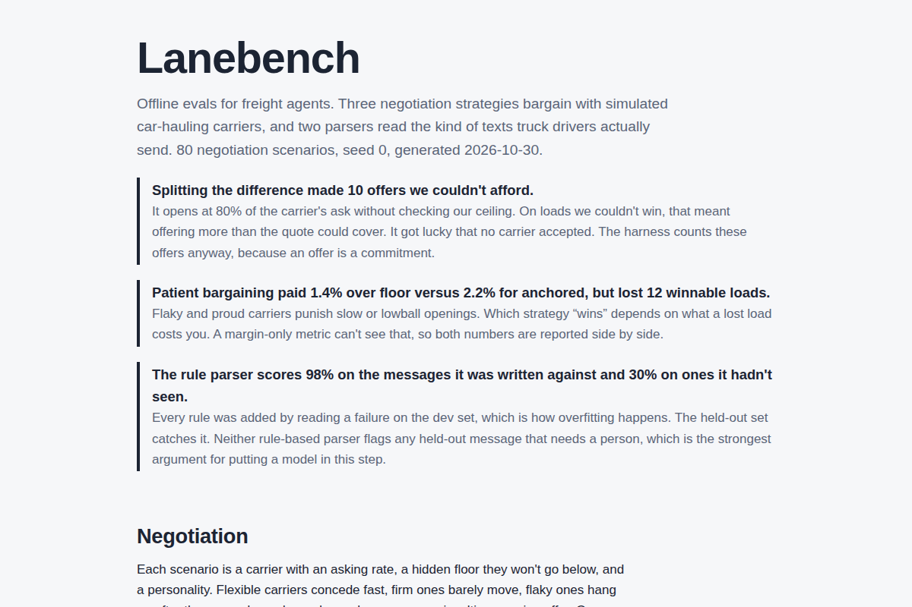

# Lanebench

Offline evals for freight agents. Lanebench scores two jobs that agents do at a vehicle-transport brokerage:

1. **Negotiating with carriers.** Three strategies bargain with simulated car haulers that have hidden price floors and different temperaments.
2. **Reading driver texts.** Parsers turn messages like "dot inspection at the scale, gonna be late. eta tmrw" into an event, an ETA, and a flag when a person needs to step in.

It started as the test harness for [Waybill](https://github.com/harish04010/waybill), the agent orchestrator, and grew into its own thing once the results got interesting.

**Report:** https://lanebench.vercel.app



## What the numbers say

From the committed run (80 scenarios, seed 0). Rerun with `python -m lanebench`.

| Strategy | Close rate on winnable loads | Offers over our ceiling | Overpay vs carrier floor | Margin kept | Loads lost |
|---|---|---|---|---|---|
| split | 100% | **10** | 6.6% | $1,832 | 0 |
| anchored | 100% | 0 | 2.2% | $3,641 | 0 |
| patient | 71% | 0 | 1.4% | $3,340 | 12 |

| Parser | Dev accuracy | Held-out accuracy | Caught messages needing a person (held out) |
|---|---|---|---|
| keyword | 52% | 30% | 0% |
| rules | 98% | 30% | 0% |

Three things stood out.

**The obvious strategy has a bug you only see in aggregate.** Split-the-difference opens at 80% of the carrier's ask and never checks our ceiling first. On loads we couldn't afford, it offered more than the customer's quote could cover, ten times. No carrier happened to accept, so a dashboard that only looked at closed deals would show nothing wrong. The harness counts every offer, because an offer is a commitment.

**"Best" depends on what a lost load costs.** Patient bargaining pays the least over each carrier's floor. Across 400 scenarios and three seeds, it even edges out anchored on total margin. But it loses about one in five winnable loads, mostly to flaky carriers who hang up after three rounds and proud ones who hang up on a lowball. Margin kept can't see the customer who goes elsewhere next time, so I report close rate next to it rather than folding both into one score. Anchored is what Waybill runs.

**I overfit the rule parser, and the held-out set caught it.** Every rule in `RuleParser` came from reading a failure on the dev set. That got it to 98% on dev and left it at 30% on 20 messages written separately: "handed keys to the sales manager," "wreck ahead, we're stopped," "loading now." It also flags none of the held-out messages that need a person. Its one dev miss is a good substring bug, too: "accident" contains "dent," so a traffic jam gets filed as vehicle damage. This is the step where a model earns its cost, and `--llm` scores Claude on the same messages.

## How it works

**Scenarios** (`carriers.py`) are generated from a seed. Each one has a lane, a market rate, the carrier's asking rate, a hidden floor, our ceiling, and a personality:

| Personality | Behavior |
|---|---|
| flexible | concedes about 45% of the gap each round |
| firm | concedes about 18% per round |
| flaky | hangs up after round three if there's no deal |
| proud | hangs up if the opening offer is under 78% of the ask |

About half the scenarios can't be won without paying more than the ceiling. On those, the right move is to walk away, and the metrics treat it that way.

**Strategies** (`negotiators.py`) see only what a real agent would: the ask, our ceiling, and the offers and counters so far. Adding one means writing a class with a `move()` method.

**Parsers** (`parsers.py`) return an event (`picked_up`, `moving`, `delayed`, `delivered`, `issue`, `none`), an ETA in hours, and a `needs_human` flag. They're scored on accuracy, macro F1, ETA within an hour, and recall on messages that need a person. Recall is the one I'd watch in production, since a missed damage report costs far more than a false alarm.

**Data** lives in `data/`. Both sets are hand-labeled JSONL. `tracking_heldout.jsonl` was written after the parsers and is only ever used for scoring.

## Running it

```bash
python -m lanebench                 # built-in strategies and parsers, no dependencies
python -m lanebench --n 400 --seed 2
pip install httpx && ANTHROPIC_API_KEY=... python -m lanebench --llm
pytest -q
```

Each run writes `results/results.json` (every run in full), `results/summary.md`, and `site/data.json`. CI reruns the benchmark and fails if `summary.md` changes, so committed numbers can't drift from the code that produced them.

To host the report, import the repo into Vercel and set the root directory to `site`.

## Limits worth knowing

- The carriers are rule-based, so a strategy could learn to exploit their exact concession curves. A model playing the carrier would make a harder and fairer opponent, and that's the next thing I'd add.
- 68 labeled messages is enough to show overfitting, not to rank close competitors. Real driver messages, labeled by ops, are the obvious upgrade.
- Hung-up counts include hopeless scenarios where walking away was correct, so read them next to close rate, not alone.
